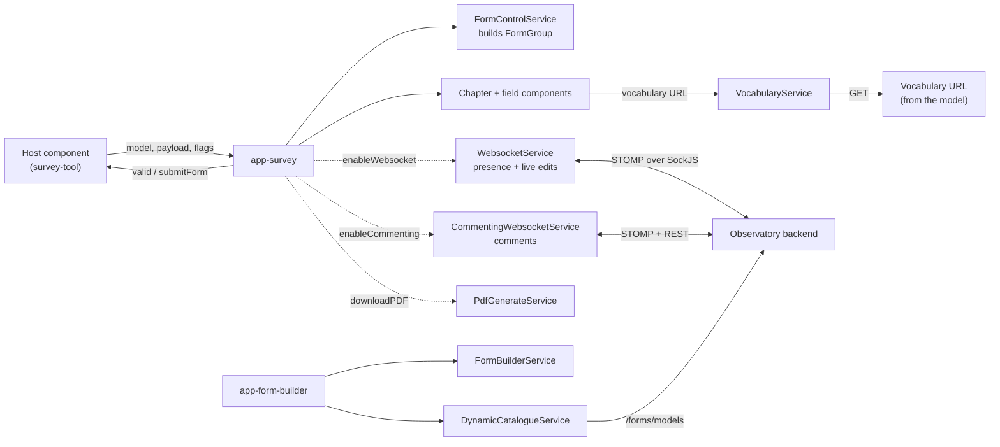

# Architecture

## Purpose and responsibilities

catalogue-ui turns a JSON **form model** into an interactive form and provides the tools around it:

- render a model (`Model` → sections → `Field`s) as a reactive form, with validation, field dependencies, paused
  fields, read-only view and version comparison;
- create and edit models (form builder and model list);
- show who else is editing an answer and apply their edits live (presence and live co-editing over STOMP);
- field-level comments with @-mentions;
- export a form with its answers to PDF;
- a rich text editor (TipTap) used by rich-text fields and by other repositories of the stack.

**Out of scope.** The library does not define routes, authenticate users, read the user's roles, know what a
"survey", "stakeholder" or "answer" is, or store answers: the host passes the model and the payload in, and receives
`valid`/`submitForm` events back. Persistence of models goes through the host's `API_ENDPOINT`.

## Structure

| Area | Location | Notes |
|---|---|---|
| Library entry module | `catalogue-ui.module.ts` | Exports `DynamicFormModule`; imports `FormBuilderModule` and the reusable components |
| Form renderer | `pages/dynamic-form` | `SurveyComponent` (`app-survey`), `ChapterComponent`, `DynamicFormFieldsComponent` and one component per field kind in `fields/` |
| Version comparison | `pages/dynamic-form/compare-versions` | `CompareModule` with `app-compare-surveys` and `app-chapter-compare` |
| Comments | `pages/dynamic-form/comments-pannel` | `CommentsPanelComponent` (`app-comments-panel`), anchors and mention highlighting |
| Form builder | `pages/form-builder` | `FormBuilderComponent` (`app-form-builder`) with main-info, side menus and field templates |
| Model list | `pages/forms-list` | `FormsListComponent`, lists models with paging and search |
| Services | `services/` | See below |
| Domain model | `domain/` | `dynamic-form-model.ts` (`Model`, `Section`, `Field`, `FieldType`, properties), paging, comments, `MentionableUsersProvider` |
| Shared | `shared/` | Pipes (`safeUrl`, `mentionHighlight`, `unique`), directives (comment anchor, measure-comment, sortable), validators, `read-more`, cookie helpers, rich text editor, script/topic utilities |
| Theme | `assets/theme`, `assets/images` | Less theme files and loaders used by the form pages |
| Configuration contract | `config/app-env.token.ts` | `APP_ENV`, `AppEnvironment`, `WsTopicsConfig` |

### Field types

`FieldType` (`domain/dynamic-form-model.ts`): `string`, `url`, `email`, `phone`, `select`, `radio`, `largeText`,
`richText`, `composite`, `chooseOne`, `number`, `bool`, `vocabulary`, `checkbox`, `date`, `scale`, `array`. Each has
properties in a typed `TypeProperties` subclass (for example `DateProperties`, `NumberProperties`,
`VocabularyProperties`).

### Services

| Service | Responsibility |
|---|---|
| `FormControlService` | Builds the `UntypedFormGroup`/`FormArray` tree and validators from a `Model` |
| `DynamicCatalogueService` | REST access to form models (`/forms/models`: list, get, create, update) |
| `FormBuilderService` | Signal-based state of the builder (current model, section, field, side-menu mode) |
| `IdGenerationService` | Generates unique field ids for the builder |
| `WebsocketService` | Presence and live co-editing over STOMP (active users, field edits, edit denied) |
| `CommentingWebsocketService` | Comment threads: REST fetch of active/resolved threads plus STOMP updates |
| `CommentAnchorService` | Tracks the vertical position and height of comment anchors so the panel can align threads with fields |
| `PdfGenerateService` | Builds a PDF document definition with pdfmake |
| `FileDownloadService` | Downloads a JavaScript object as a JSON file (used for the model export in the builder) |
| `VocabularyService` | Fetches the vocabulary list for a `vocabulary` field from the URL declared in the model |

## Data flow

`SurveyComponent` inputs: `model`, `payload`, `subType`, `userId`, `enableWebsocket`, `enableCommenting`,
`downloadPDF`, `mandatoryFieldsText`, `tabsHeader`, `errorMessage`, `successMessage`, `freeView`. Outputs: `valid`,
`submitForm`. Presence and comments are **opt-in**: nothing connects to the backend unless the host sets
`enableWebsocket` / `enableCommenting`. `FormBuilderComponent` takes `customActions` and `backDestination` inputs.

## Extension points for the host

| Token / input | Purpose |
|---|---|
| `APP_ENV` (`InjectionToken<AppEnvironment>`) | Endpoints and optional STOMP topic overrides, see [configuration.md](configuration.md) |
| `MentionableUsersProvider` (abstract class) | Supplies the users that can be @-mentioned in comments. The default returns no users; survey-tool provides `StakeholderMentionableUsersProvider` |
| Component inputs above | Behaviour switches (websocket, commenting, PDF, read-only) |

## Persistence and external services

Only form models are persisted through the library (via the backend). Answers, comments' storage and presence state
live in the backend. The browser keeps nothing beyond component state.

## Authentication and authorisation relationship

None inside the library. Requests rely on the host's session cookie and XSRF configuration; STOMP connects send the
`X-XSRF-TOKEN` header. Who may edit or comment is decided by the backend, which can answer a live edit with an
"edit denied" message that the library surfaces. See [security.md](security.md).

## Constraints and decisions

- Distributed as **source** inside the host's compilation, not as an npm package: the host must provide the peer
  packages, styles and assets listed in [configuration.md](configuration.md).
- The library is the only layer of the stack that does not import from the host application (it uses `APP_ENV`).
- TipTap replaced CKEditor 5 (a breaking change of the next major version) so that no GPL component is shipped.
- Components are being moved to signal inputs and standalone declarations; both styles coexist.
