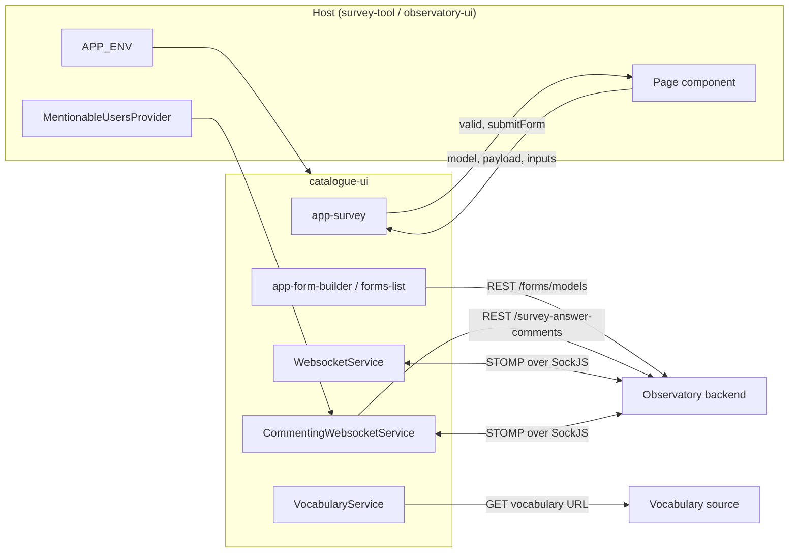

# Integration

catalogue-ui talks to the Observatory backend through the host's `APP_ENV` endpoints and exposes a small set of
Angular extension points to the host. Endpoint paths, parameters and schemas are owned by the backend's Swagger/OpenAPI
documentation (TODO(backend maintainers): link); this document lists what the library depends on.

## Backend integrations

| Counterpart | Direction | Purpose | Protocol | Endpoint configuration | Authentication |
|---|---|---|---|---|---|
| Forms API | Library → backend | List, read, create and update form models for the builder and model list | REST/JSON: `GET /forms/models` (`from`, `quantity`, `sort`, `order`, `keyword`), `GET /forms/models/{id}`, `POST /forms/models`, `PUT /forms/models/{id}` | `API_ENDPOINT` | Host session cookie; XSRF header on `POST`/`PUT` |
| Comments API | Library → backend | Load comment threads of an answer (`targetId`, `status` of `ACTIVE`, `RESOLVED`, `DELETED` or `HIDDEN`) | REST/JSON: `GET /survey-answer-comments` | `API_ENDPOINT` | Host session cookie |
| Presence and live edit | Library ↔ backend | Active users, field focus, field edits, edit denied | STOMP over SockJS (see topics in [configuration.md](configuration.md)) | `WS_ENDPOINT`, `WS_TOPICS` | Session cookie; `X-XSRF-TOKEN` in the CONNECT headers |
| Comments live updates | Library ↔ backend | Create, edit, delete threads and messages; receive updates | STOMP over SockJS | `WS_ENDPOINT`, `WS_TOPICS` | Same as above |
| Vocabulary source | Library → any HTTP source | Options of a `vocabulary` field | `GET <url>` where the URL comes from the field's `VocabularyProperties`, with `urlParams` placeholders replaced from other field values | The form model | None added by the library |

The backend decides who may read or change a model, an answer or a comment; the library only displays the result.

## Host contract

| What | Direction | Detail |
|---|---|---|
| `APP_ENV` | Host → library | Required, see [configuration.md](configuration.md) |
| `model: Model`, `payload` | Host → `app-survey` | The form definition and the answer to display |
| `userId`, `subType` | Host → `app-survey` | Identify the current user and the survey sub-type for presence and comments |
| `valid`, `submitForm` | `app-survey` → host | Validity of the form and the submitted `UntypedFormGroup`. Saving the answer is the host's job |
| `MentionableUsersProvider` | Host → library | `getUsers(contextId)` returns `{ email, name? }[]`; set `contextId` to scope the list. Without a host provider, no one can be mentioned |
| Flags | Host → library | `enableWebsocket`, `enableCommenting`, `downloadPDF`, `freeView` |
| Websocket scripts | Host → library | `assets/js/sockjs.min.js` and `stomp.min.js` must be reachable |

In this repository stack, survey-tool is the host of the library and observatory-ui compiles both. Other hosts need
only satisfy the table above.

## Failure behaviour

- **STOMP connection lost or failing:** the presence and comments services reconnect automatically, with a new SockJS
  instance for each attempt. They retry every second for roughly two minutes (about 120 attempts) and then every 10
  seconds, until the component that enabled them is destroyed (`dropConnection`). On reconnect the join message is resent so
  presence recovers. While disconnected the active-users list is cleared and live edits/comments do not update; the form
  itself stays usable.
- **Live edit refused:** the backend can reply on the `editDenied` topic; the library emits it to the form so the host
  or component can inform the user.
- **REST errors:** no retry and no timeout is applied in the library. Errors from the comments fetch are logged with
  `console.error`; model list and model calls return the error to their component.
- **Vocabulary URL unreachable or not CORS-enabled:** the field cannot load its options; other fields are unaffected.
- **Script loading:** if `sockjs.min.js` or `stomp.min.js` cannot be loaded, the connection promise rejects and
  presence/comments stay inactive.
